# QoS-Aware Hybrid Cloud Task Scheduler

> A deadline-aware batch control plane that keeps two local workers busy, and starts one EC2 burst worker only when that spend can still save a job.

This is the UCS531 Cloud Computing scheduler. You submit a vibration recording, the control plane forecasts local and cloud finish times, and a worker publishes frequency and lag scores once the artifact checksum matches. PostgreSQL is the queue. Two single-slot Docker workers pull work. The QoS policy starts or reuses one EC2 worker when the forecast shows it can meet the deadline inside the job budget and the run budget.

A placement is a recorded decision, with both predicted finishes, a reason, and the budget comparison. Money is stored as integer microdollars. A lost or timed-out attempt may retry once. A missed deadline is stored as an outcome, and a successful result stays downloadable.

**Hosted dashboard:** [4k3efjo42g.execute-api.us-east-1.amazonaws.com](https://4k3efjo42g.execute-api.us-east-1.amazonaws.com)
**AWS runbook:** [aws/HOSTED.md](aws/HOSTED.md)
**Submission index:** [docs/submission/README.md](docs/submission/README.md)

---

## Table of Contents

- [Core Concept](#core-concept)
- [Features](#features)
- [Tech Stack](#tech-stack)
- [Architecture](#architecture)
- [Job Lifecycle](#job-lifecycle)
- [Controller and Capacity](#controller-and-capacity)
- [Placement Policies](#placement-policies)
- [Data Model](#data-model)
- [Vibration Analysis](#vibration-analysis)
- [Workers and Compute](#workers-and-compute)
- [API Reference](#api-reference)
- [Authentication](#authentication)
- [Artifact Storage](#artifact-storage)
- [Dashboard](#dashboard)
- [AWS Deployment](#aws-deployment)
- [Observability and Evaluation](#observability-and-evaluation)
- [Repository Structure](#repository-structure)
- [Getting Started](#getting-started)
- [Glossary](#glossary)

---

## Core Concept

The HTTP response admits the job. Completion still has to pass through the queue, a fenced attempt, and a verified artifact:

1. The client `POST`s job metadata with an `Idempotency-Key`. The row is created as `AWAITING_INPUT`. Repeating the same key and the same request hash returns the existing job.
2. The client `PUT`s the CSV. The bytes must match `inputSha256`, fit the upload window, and pass sample checks. Admission moves the job to `QUEUED`.
3. Once a second, the scheduler ranks the queue and commits one job per free slot. QoS stays local when the local forecast meets the deadline, and opens EC2 when the cloud forecast is the one that still lands on time.
4. A worker claims the assignment, runs the analysis in a child process, heartbeats the lease, and uploads the result. The API publishes the job only after it recomputes the SHA-256.
5. If the worker disappears, the lease expires. A transient failure before the second attempt returns the job to `QUEUED`. `invalid_input` fails the job immediately.

Throughout, the dashboard polls job, queue, and operator state. There is no WebSocket channel. PostgreSQL plus the REST API is the source of truth.

---

## Features

- **Three placement policies** in one control plane: FCFS, priority, and QoS. The active policy is `POLICY` (default `qos`).
- **Hybrid capacity:** two local slots (`local-1`, `local-2`) and one EC2 slot (`ec2-1`) that stays stopped until a placement needs it.
- **Deadline and budget gating.** Cloud placement is refused when the slot is missing, the job cannot reserve the execution, or the run budget cannot cover the reservation plus idle reserve.
- **Escrow-style spend.** Budgets, reservations, and observed EC2 compute are integer microdollars. One USD is `1_000_000` microdollars.
- **Fenced workers.** Each process boots with a generation UUID. A stale generation inside the lease window is rejected, so a restarted daemon cannot finish another process's attempt.
- **One retry.** A transient failure retries while `attempt.number < 2` and the job is still inside the queue-wait limit.
- **Immutable artifacts.** Inputs live at `inputs/{jobId}/recording.csv`. Outputs live at `attempts/{jobId}/{attemptId}.json`. S3 writes use `IfNoneMatch: *`.
- **Signed EC2 identity.** Burst workers prove an Instance Identity Document before registration. IMDSv2 is required on the instance.
- **Operator and student accounts.** Each token sees only its own jobs. Run start, finish, operations, and metrics require the operator flag.
- **Evaluation harness** that replays the same arrivals under all three policies and writes comparison JSON.

---

## Tech Stack

| Layer | Technology | Role |
|-------|------------|------|
| **App** | Next.js 16 · React 19 | Dashboard and the catch-all `/api/*` route |
| **Language** | TypeScript on Node.js 22 | Control plane, workers, evaluation |
| **Validation** | Zod 4 | Job specs, accounts, evaluation settings |
| **Database** | PostgreSQL 17 (`pg`) | Queue, attempts, runs, capacity, telemetry |
| **Local compute** | Docker Compose | Postgres, migrate, web, scheduler, two workers |
| **Cloud compute** | EC2 `t3.small` · Docker | Single burst worker, stopped when idle |
| **Artifacts** | Local disk or Amazon S3 | CSV inputs and JSON results |
| **Identity** | HMAC session cookies · bearer tokens · EC2 IID | Dashboard, scripts, and workers |
| **Telemetry** | CloudWatch Logs and Metrics | Queue depth, worker loss, startup, cost |
| **IaC** | CloudFormation | Data, app, gateway, edge, worker, observability |

---

## Architecture

The web tier answers short requests. A separate scheduler process is the only loop that ranks jobs and starts or stops EC2. Workers claim through the API, so a laptop worker and the EC2 worker share one admission path.

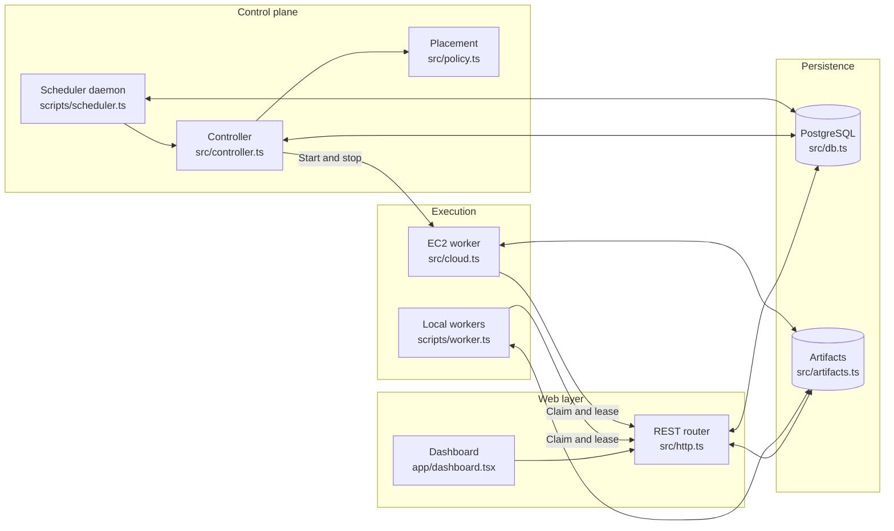

Local Compose wires the same split into containers. Migrations finish before `web` and `scheduler` start. Both workers call `http://web:3000` and never open Postgres.

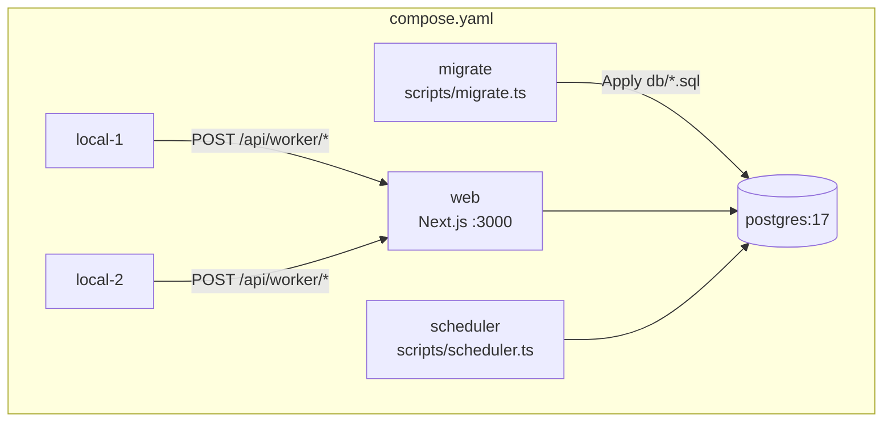

Worker containers run `read_only`, drop every capability, set `no-new-privileges`, and cap memory at 512 MB. CPU share comes from `LOCAL_WORKER_CPUS` (default `1.0`).

---

## Job Lifecycle

`src/jobs.ts` owns the transitions. Every mutation runs inside `transaction()` in `src/db.ts`: `BEGIN`, `pg_advisory_xact_lock(531, 1)`, the work, then `COMMIT` or `ROLLBACK`. That lock serializes API writes and controller writes across processes.

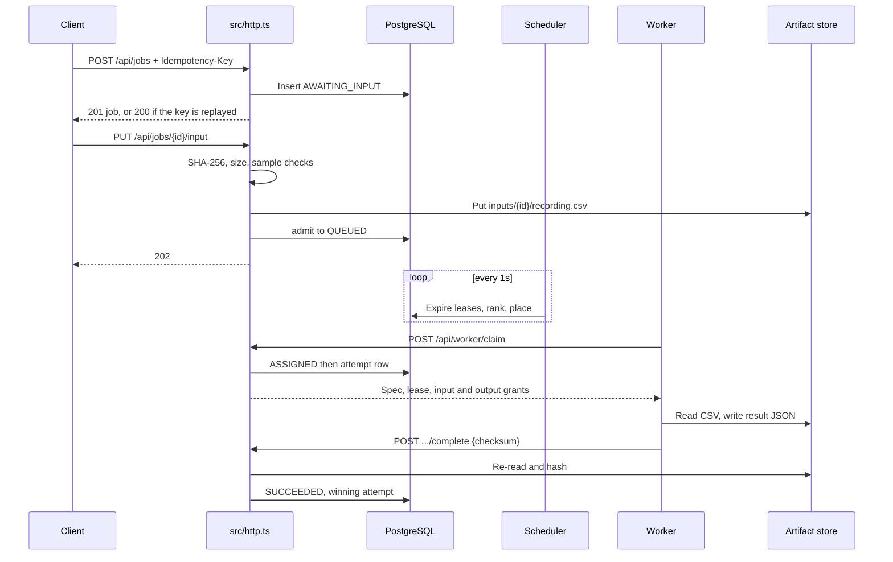

States:

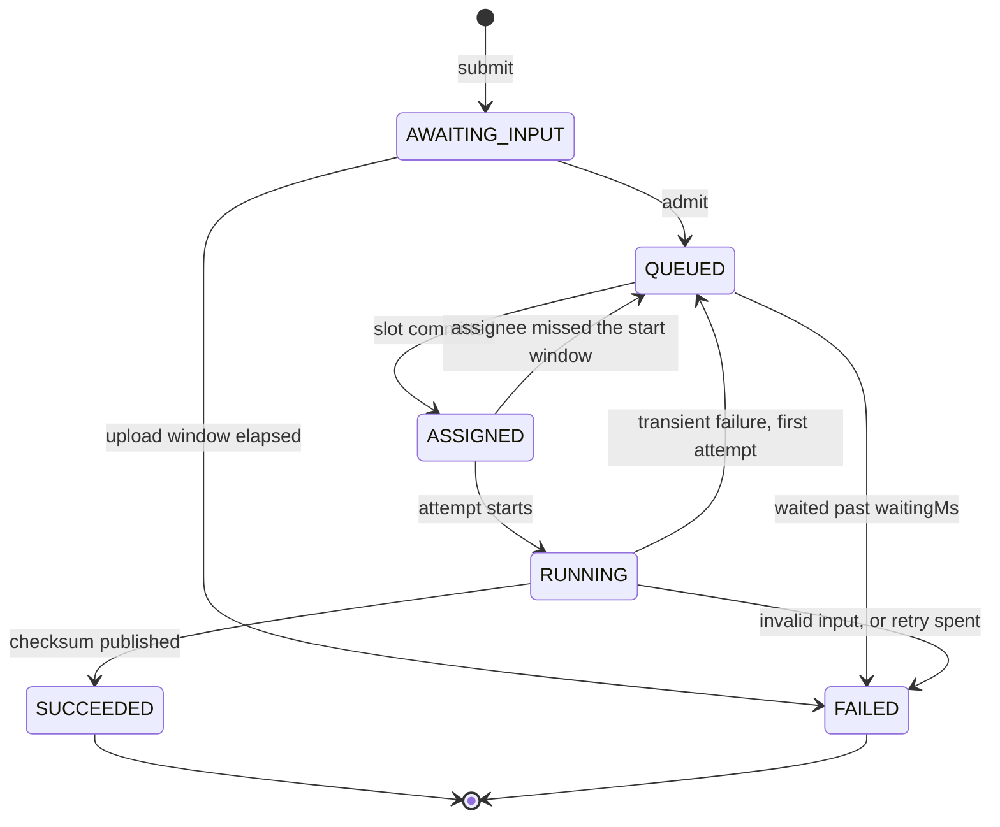

| Piece | What it records |
|-------|-----------------|
| **Run** | One active policy, calibration, and budget. A partial unique index allows a single open run. |
| **Job** | Spec, owner, idempotency key, request hash, microdollar budget, spent and reserved amounts, status, decision JSON. |
| **Attempt** | Target, worker, generation, lease end, outcome, failure, output SHA-256. Number starts at 1. |
| **Event** | Append-only timeline (`queued`, `succeeded`, `retrying`, `failed`, and others) for `GET /api/jobs/{id}/events`. |

`startRun` refuses to rotate the policy while jobs are active or a local worker is stale. `endRun` waits until every job in the run is terminal and every capacity session has stopped.

---

## Controller and Capacity

`scripts/scheduler.ts` loads `.env`, builds a capacity driver and a telemetry publisher, and runs two loops until `SIGINT` or `SIGTERM`:

| Loop | Interval | Work |
|------|----------|------|
| Controller | 1 second | `controller.observe()`, then `controllerTick`. A failed EC2 describe is logged as `ec2_observation_failed` and treated as state `unknown`. |
| Telemetry | 5 seconds | Flush unsent rows when CloudWatch is configured. |

`controllerTick` takes a session advisory lock with `pg_try_advisory_lock(531, 2)`. If the lock is held, that tick is skipped. The lock is released when the tick finishes.

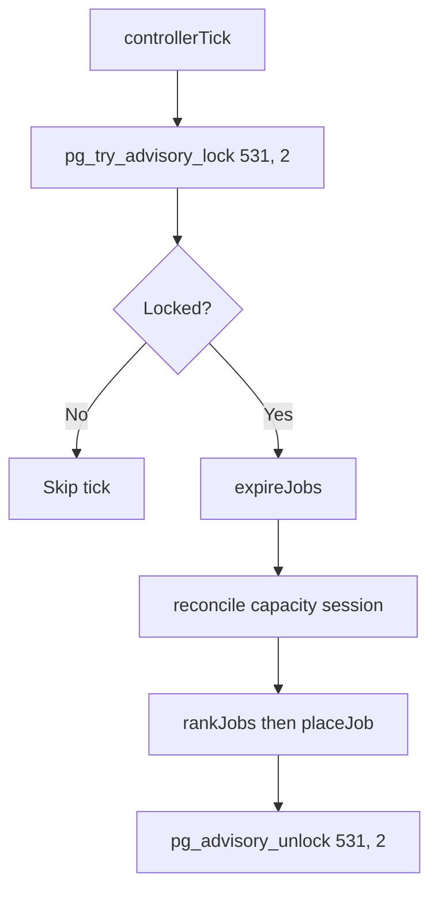

`expireJobs` applies the clocks in `src/domain.ts`:

| Limit | Value | Effect |
|-------|------:|--------|
| `uploadMs` | 600000 | `AWAITING_INPUT` older than this fails. The upload route also returns `410`. |
| `waitingMs` | 900000 | A queued job that waits this long fails. |
| `leaseMs` | 20000 | A silent attempt is lost and can be retried. |
| `heartbeatMs` | 5000 | Worker pause between lease renewals. |
| `executionMs` | 180000 | Cap on one attempt. |
| `ageMs` | 120000 | QoS aging threshold. |
| `startupMs` | 90000 | EC2 must become ready, or the session is `cloud_startup_timeout`. |
| `idleMs` | 60000 | Idle EC2 is asked to stop. |
| `stopGraceMs` | 20000 | Feeds the `StopOverdue` metric. |
| `cooldownMs` | 120000 | Gap before another cloud start. |

`reconcile` maps EC2 observations onto `capacity_sessions`: requested, running, ready, idle, stop requested, stopped. Startup cost is charged from the observed transition time when EC2 reports one, including when the controller itself was down. `src/cloud.ts` issues `DescribeInstances`, `StartInstances`, and `StopInstances` with a short describe timeout.

On the instance, `aws/prepare-worker.sh` checks the image digest and pulls the IID from IMDSv2 into `/run/qos-worker/identity`. `aws/worker-watchdog.sh` skips the first 150 seconds of uptime, then powers the instance off if `/run/qos-worker/contact/last` is older than 35 seconds.

---

## Placement Policies

`rankJobs` orders the queue. `placeJob` picks `local` or `ec2` and stores the reason.

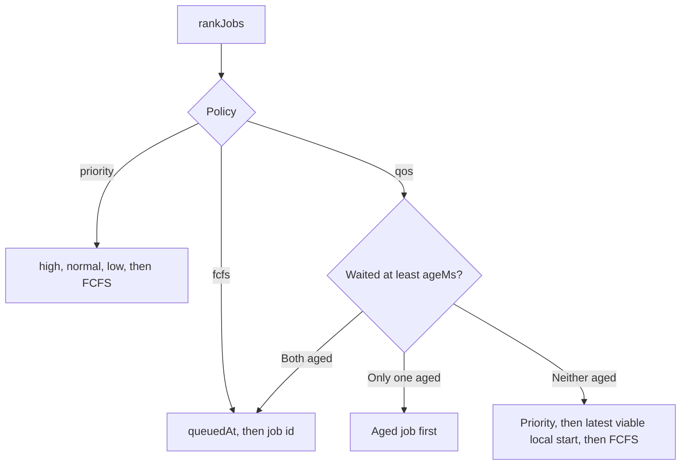

Service time is `serviceMs(job, target, calibration)`: scaled compute, bytes divided by target throughput, plus a fixed overhead. Defaults from `src/config.ts` are a cloud runtime ratio of `1`, local throughput `2_000_000` B/s, cloud throughput `5_000_000` B/s, local fixed overhead `0.4 s`, and cloud fixed overhead `0.5 s`. Cold EC2 adds the startup allowance before the reservation is priced with `computeCost`, which rounds up to the next microdollar.

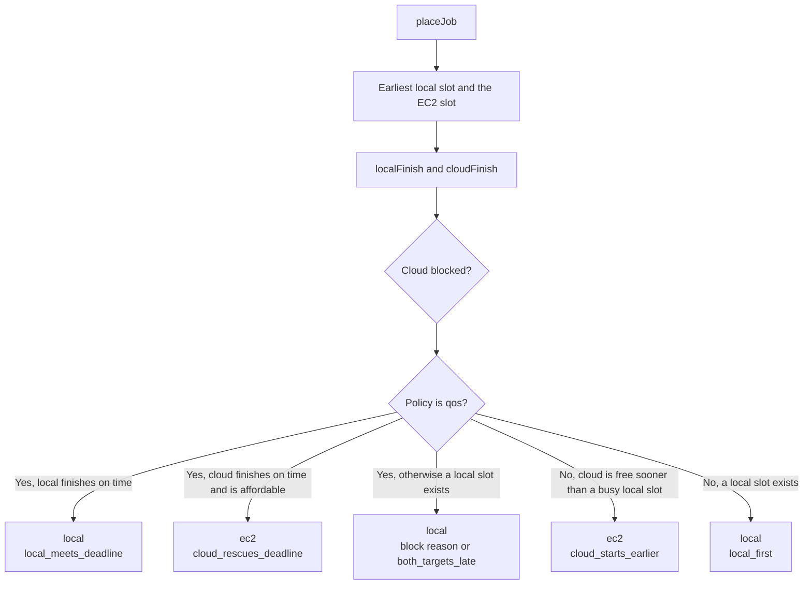

Cloud is blocked for one of three reasons:

| Code | Meaning |
|------|---------|
| `cloud_unavailable` | No EC2 slot is in the pool. |
| `job_budget` | Remaining job budget cannot cover the reservation. |
| `run_budget` | Reservation plus idle reserve exceeds the run remainder. |

Other reasons you will see on the job: `cloud_only_available`, `no_available_worker`, `both_targets_late`, `local_first`, `local_meets_deadline`, `cloud_rescues_deadline`, `cloud_starts_earlier`.

The forecast used for a decision includes work already committed to each slot, earlier jobs in policy order, the calibration above, and whether EC2 is already running. Placement rows keep both finish predictions so a later reader can see why the other target lost.

---

## Data Model

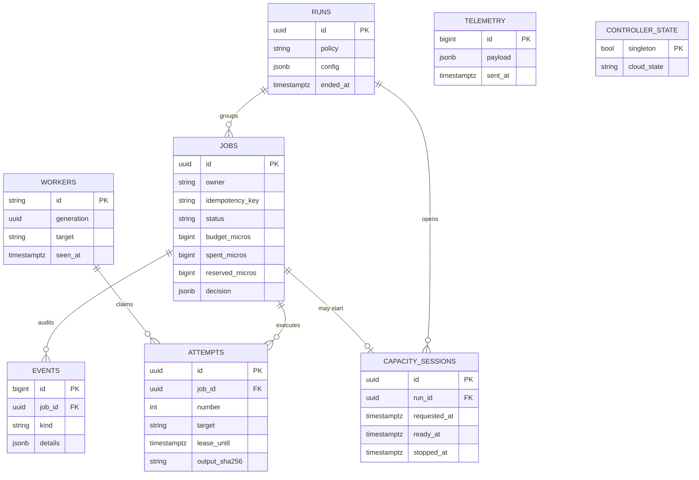

Notable constraints in `db/001_initial.sql` and `db/002_controller_state.sql`:

- `runs_one_active` keeps a single run with `ended_at IS NULL`.
- `(owner, idempotency_key)` is unique.
- `jobs_one_per_slot` allows one `ASSIGNED` or `RUNNING` job per worker.
- `capacity_one_open` allows one open cloud session.
- `controller_state` is a single row (`CHECK (singleton)`).
- `telemetry_unsent` indexes rows still waiting for CloudWatch.

`src/db.ts` parses PostgreSQL `BIGINT` (OID 20) as a JavaScript number and pools at most 8 clients.

---

## Vibration Analysis

The only job type is `vibration-v1`. `src/vibration.ts` decodes the CSV and scores lags. `scripts/compute.ts` is the child process that actually calls it, so a bad file cannot take down the worker loop.

Parsing rules:

- At most `limits.bytes` (2 MiB), UTF-8, fatal on bad sequences.
- Optional header row `sample`, matched case-insensitively.
- Between 2 and 250,000 samples.
- Each line is a signed 16-bit integer matching `^[+-]?\d{1,5}$`, stored in an `Int16Array`.
- `maxLag` is below the sample count, and `maxLag - minLag` is under 2,048.

For each lag from `minLag` through `maxLag`, the score is the sum of `samples[i] * samples[i + lag]` over the overlapping window. Comparison uses `BigInt` so the best lag is chosen without floating-point drift. The published frequency is `sampleRate / bestLag`.

The child process reads the spec from `argv` and the CSV from stdin. Exit `0` writes JSON to stdout. Exit `2` is `invalid_input`. Any other non-zero exit is `compute_failed`.

The fixture in `docs/submission/sample-vibration.csv` is an 8-sample square wave. Submitted at 1,000 Hz with lags 2 through 4, expected local runtime 1 second, a future deadline, and a zero cloud budget, the result is scores `[-2, 0, 2]`, lag `4`, and frequency `250` Hz.

```csv
sample
2
0
-2
0
2
0
-2
0
```

---

## Workers and Compute

Three slots share one daemon: `scripts/worker.ts`. Required environment: `WORKER_ID`, `WORKER_TOKEN`, `WORKER_API_URL`. `ec2-1` also needs `WORKER_IDENTITY_DOCUMENT` and `WORKER_IDENTITY_SIGNATURE`.

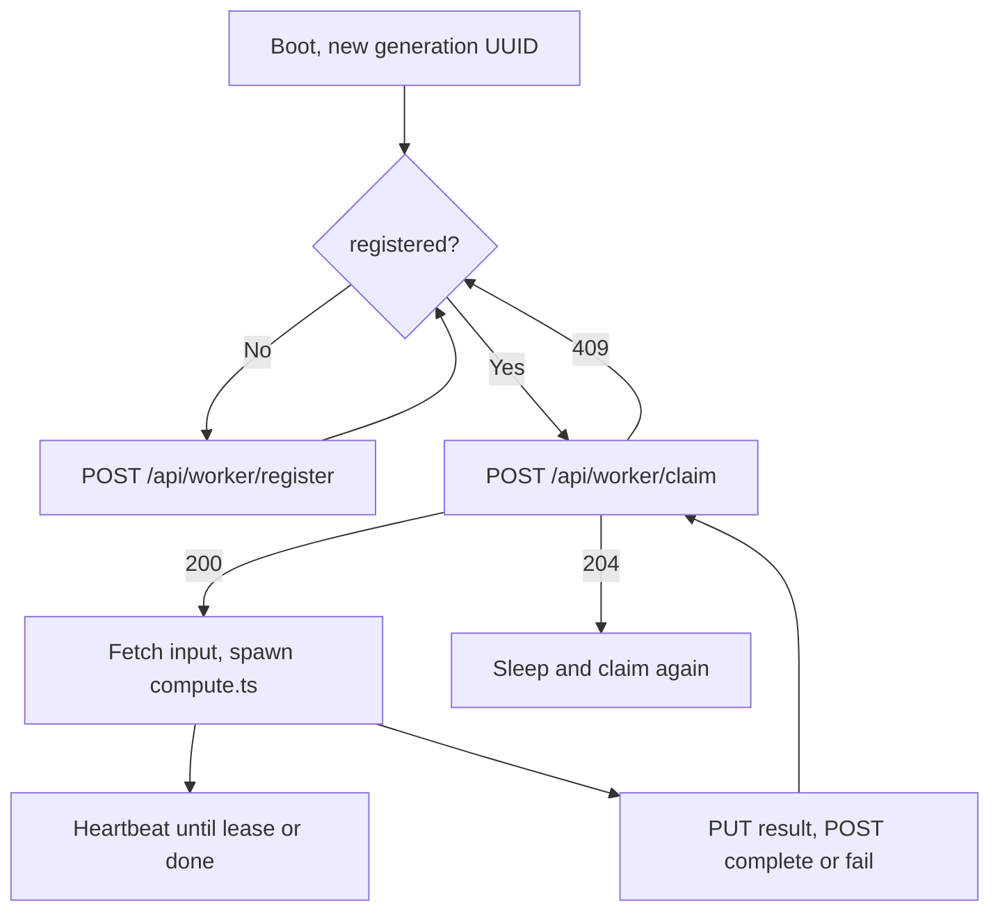

On each attempt the daemon:

1. Downloads the CSV from the granted URL or, in local mode, `GET /api/worker/attempts/{id}/artifact`.
2. Spawns `node --import tsx scripts/compute.ts` and writes the CSV to its stdin.
3. Renews the lease every `heartbeatMs`. A `401`, a `409`, or a passed `leaseUntil` aborts the child.
4. Uploads JSON with `If-None-Match: *`, then `POST`s `{ "checksum": "<sha256>" }`.
5. On failure, `POST`s one of `input_fetch_failed`, `invalid_input`, `compute_failed`, `output_upload_failed`, `timed_out`.

The image is a multi-stage Dockerfile: `dependencies`, `build`, `lab` (and `hosted`) for the Next.js process, and a slim `worker` stage whose command is the daemon. `compose.workers.yaml` is the overlay for pointing laptop slots at a hosted API. `compose.aws.yaml` bind-mounts the EC2 identity certificate and pins the worker image by digest.

When the API is private, `scripts/worker-relay.ts` listens on TLS port `38444` and forwards only `/api/worker/register`, `/api/worker/claim`, and `/api/worker/attempts/{id}/(heartbeat|complete|fail)` through an SSH tunnel prepared by `aws/prepare-ssm-relay.sh`.

---

## API Reference

Base URL for the local stack: `http://localhost:3000/api`.

Browser calls send the `qos_session` cookie. Scripts send `Authorization: Bearer <token>`. Worker calls send the worker bearer token plus `x-worker-id` and `x-worker-generation`.

JSON bodies are size-capped (`readJson`, default 32 KB, larger for run manifests). `Fault` responses use the status on the error. Zod failures return `422` with dotted paths. Anything else is logged and returned as `503`.

### Public

| Method | Path | Behavior |
|--------|------|----------|
| `GET` | `/health` | Runs `SELECT 1 FROM jobs LIMIT 1`. Returns `{ "status": "ok" }`. |
| `POST` | `/session` | Body `{ "token" }`. Sets `qos_session` (`HttpOnly`, `SameSite=Lax`, 8 hours). `secure` when `COOKIE_SECURE=true`. |
| `DELETE` | `/session` | Clears the cookie. |

`POST` and `DELETE` on `/session` must pass the same-origin check. A `cross-site` `Sec-Fetch-Site`, an `Origin: null`, or an origin other than `PUBLIC_ORIGIN` (or the request host, when that variable is unset) returns `403`.

### Jobs

The caller must be the job owner. List results are newest first, 100 rows per page.

| Method | Path | Behavior |
|--------|------|----------|
| `POST` | `/jobs` | Header `Idempotency-Key` (1 to 128 chars). Body is a `vibration-v1` spec. `201` on create, `200` when the key and request hash match, `409` when the key is reused with a different hash. |
| `GET` | `/jobs` | Filters: `state`, `priority`, `target`, `offset`. Response is `{ jobs, nextOffset }`. |
| `GET` | `/jobs/{id}` | Job plus attempts ordered by `number`. |
| `PUT` | `/jobs/{id}/input` | Raw CSV. Checksum must equal `inputSha256`. `202` after admit. `422` on a bad checksum or an illegal lag. `410` when the upload window has closed. A second upload after admission returns the job unchanged. |
| `GET` | `/jobs/{id}/events` | `{ id, at, kind, details }` in insert order. |
| `GET` | `/jobs/{id}/result` | `409` until a winning attempt exists. In AWS mode, `303` to a 300-second S3 URL. `?download=1`, or local disk mode, streams `application/json` as `{id}.json`. |

Job body fields:

| Field | Rule |
|-------|------|
| `type` | `vibration-v1` |
| `sampleRate` | Positive number, at most 10,000,000 |
| `minLag`, `maxLag` | Integers, `maxLag >= minLag`, span under 2,048 |
| `priority` | `low`, `normal`, or `high` |
| `expectedSeconds` | 1 to 180 |
| `deadline` | ISO 8601 datetime with a numeric offset, in the future |
| `budgetUsd` | Decimal string, up to 4 digits and 6 fractional digits |
| `inputSha256` | 64 lowercase hex characters |
| `runId` | Optional UUID, used by the evaluation harness |

Queue admission also rejects a backlog past `limits.jobs` (100).

### Runs

Operator only.

| Method | Path | Behavior |
|--------|------|----------|
| `GET` | `/runs` | Recent run summaries. |
| `POST` | `/runs` | Body `{ label, policy, manifest }`. `201` with the new run. `manifest` may be up to 128 KB. |
| `GET` | `/runs/operations` | Live operator snapshot: workers, capacity, queue counts, controller freshness. |
| `GET` | `/runs/{id}/metrics` | Aggregate wait, completion, deadline hits, makespan, EC2 sessions, estimated compute. |
| `POST` | `/runs/finish` | Body `{ "id": "<run uuid>" }`. `204` when every job is terminal and cloud sessions have stopped. |

### Workers

Workers authenticate with their own bearer token and generation header. EC2 registration is checked with `verifyRegistration` against `aws/certs/ec2-iid.pem` (or `EC2_IDENTITY_CERT`): RSA-SHA256 over the instance document, then instance id, account, and region must match the environment. The image digest must match the pinned digest.

| Method | Path | Behavior |
|--------|------|----------|
| `POST` | `/worker/register` | Body `{ document?, signature?, imageDigest? }`. Local workers send an empty object. `204`. `409` if another live generation still holds the id. |
| `POST` | `/worker/claim` | `200` with `jobId`, `attemptId`, `spec`, `executionUntil`, `leaseUntil`, and artifact grants. Empty `204` when the slot has nothing assigned. |
| `POST` | `/worker/attempts/{id}/heartbeat` | Returns the new `{ leaseUntil }`. |
| `GET` | `/worker/attempts/{id}/artifact` | Local mode only. Streams the CSV. In S3 mode the claim payload carries a 210-second presigned GET instead. |
| `PUT` | `/worker/attempts/{id}/artifact` | Local mode only. Stores the JSON result, capped at 256 KB. S3 mode uses a presigned PUT with `If-None-Match`. |
| `POST` | `/worker/attempts/{id}/complete` | Body `{ "checksum" }`. Re-reads the object and compares hashes before `finishAttempt`. A repeated complete with the same checksum is a no-op. |
| `POST` | `/worker/attempts/{id}/fail` | Body `{ "failure" }` using the five stage names above. `invalid_input` is permanent. The others are transient. |

**Submit the sample, then upload it:**

```bash
TOKEN="<student-or-operator-token>"
SHA="$(sha256sum docs/submission/sample-vibration.csv | awk '{print $1}')"

curl -sS -X POST http://localhost:3000/api/jobs \
  -H "Authorization: Bearer $TOKEN" \
  -H "Idempotency-Key: sample-250hz" \
  -H "Content-Type: application/json" \
  -d "{\"type\":\"vibration-v1\",\"sampleRate\":1000,\"minLag\":2,\"maxLag\":4,\"priority\":\"normal\",\"expectedSeconds\":1,\"deadline\":\"2026-12-01T00:00:00+00:00\",\"budgetUsd\":\"0\",\"inputSha256\":\"$SHA\"}"

# Use the id from that response.
curl -sS -X PUT "http://localhost:3000/api/jobs/$JOB_ID/input" \
  -H "Authorization: Bearer $TOKEN" \
  -H "Content-Type: text/csv" \
  --data-binary @docs/submission/sample-vibration.csv
```

Replace the deadline with a timestamp that is still in the future.

---

## Authentication

Dashboard accounts live in `DASHBOARD_ACCOUNTS`, a JSON object of `{ token, operator }`. `npm run env:init` creates an operator and a student, each with a 32-byte hex token. Hosted deployments derive the same actors from one 64-character `RuntimeSeed` with HMAC-SHA256 and the label `ucs531/hosted/v1/{session|operator|student|local-1|local-2|database}`.

Token comparison hashes both sides with SHA-256 and then uses `timingSafeEqual`. Session cookies are `accountId.expiry.hmac`, signed with `SESSION_SECRET` (at least 32 characters). `cookieAccount` checks the shape, the expiry, the signature, and that the account still exists.

`requireAccount` accepts a bearer token or the cookie. Non-GET requests without a bearer token must pass `sameOrigin`. Missing credentials are `401`. An operator-only route with a student token is `403`.

Workers resolve `WORKER_TOKEN_<ID>` from the environment (`WORKER_TOKEN_LOCAL_1`, `WORKER_TOKEN_LOCAL_2`, `WORKER_TOKEN_EC2_1`). The generation header must be a UUID, and the configured token must be at least 24 characters.

---

## Artifact Storage

`src/artifacts.ts` picks S3 when `AWS_S3_BUCKET` is set, and a local directory (`ARTIFACT_DIR`, default `.data/artifacts`) otherwise.

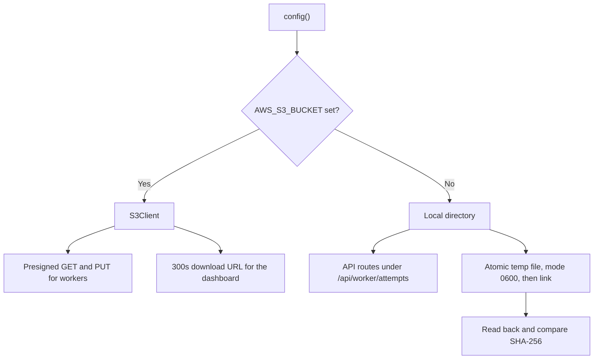

Local puts write a temp file, link it into place, and read it back. A checksum mismatch raises `409`. S3 puts send a checksum and `IfNoneMatch: *`; `PreconditionFailed` is treated as a concurrent write. Reads refuse objects over the caller's limit with `413`. `boundedBody` enforces `Content-Length` and cancels the stream if the running total exceeds the cap.

---

## Dashboard

`app/page.tsx` reads `qos_session` on the server. A valid cookie renders `Dashboard`. Otherwise the page shows `SignIn`, which `POST`s the project token to `/api/session` and reloads.

Signed-in views are `jobs`, `new`, and `operator` (operator accounts). `?job=<uuid>` opens a job. Navigation uses `history.replaceState`, so the queue and the detail share one page.

`usePoll` refetches on a 3 second timer and aborts the previous request. The jobs view lists state, priority, target, and deadline outcome. The detail view shows the decision reason in plain language (`local_meets_deadline`, `cloud_rescues_deadline`, `job_budget`, and the rest), the attempt timeline, and a result download. The new-job form collects the vibration spec and the CSV. The operator view reads `/api/runs/operations` for queue depth, worker health, and the EC2 session.

Colors and type live in `app/tokens.css`. Layout, focus rings, and the skip link live in `app/styles.css`.

---

## AWS Deployment

The hosted lab is a private VPC `10.53.0.0/16` in `us-east-1`. The app host has no public IPv4 address. Clients enter through API Gateway, a VPC link, and Cloud Map. An optional CloudFront distribution can sit in front after AWS verifies the account. RDS PostgreSQL is single-AZ `db.t4g.micro`, encrypted, without a public endpoint, and the app connects with `sslmode=verify-full` pinned to `aws/certs/rds.pem`.

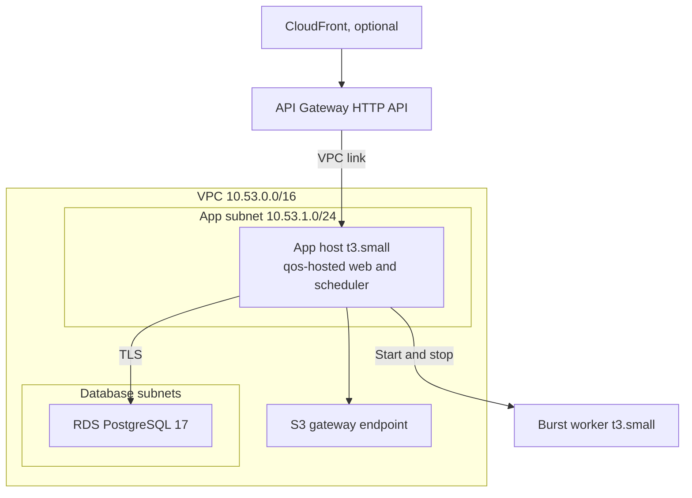

CloudFormation is split on purpose:

| Template | What it creates |
|----------|-----------------|
| `aws/cloud-hosted-data.yaml` | VPC, subnets, RDS, S3 endpoint, `RuntimeSeed`, burst worker token |
| `aws/cloud-hosted-app.yaml` | Private app instance, `AppRole`, `qos-hosted@web`, `qos-hosted@scheduler` |
| `aws/cloud-hosted-gateway.yaml` | HTTP API, VPC link, Cloud Map |
| `aws/cloud-hosted-edge.yaml` | Optional CloudFront VPC origin, caching disabled |
| `aws/cloud-hosted-worker.yaml` | Burst worker binding |
| `aws/cloud-resources.yaml` | Shared S3 bucket, ECR, worker instance profile, `WebRole`, `ControllerRole` |
| `aws/cloud-observability.yaml` | Log groups and alarms |

`aws/deploy-hosted.ps1` applies those stages in order: Data, App, Gateway or Edge, Worker. `aws/use-hosted.ps1` reads `RuntimeSeed`, derives operator and student tokens, and can write `.env.aws-workers` so laptop slots join the hosted API:

```powershell
docker compose --env-file .env.aws-workers -f compose.workers.yaml up -d
```

IAM is split the same way. `CredentialsIssuer` may only assume `WebRole` and `ControllerRole`. `WebRole` may get and put `inputs/*` and `attempts/*`. `ControllerRole` may describe, start, and stop the burst instance and publish metrics. `WorkerRole` may pull from ECR, write its log stream, and use SSM.

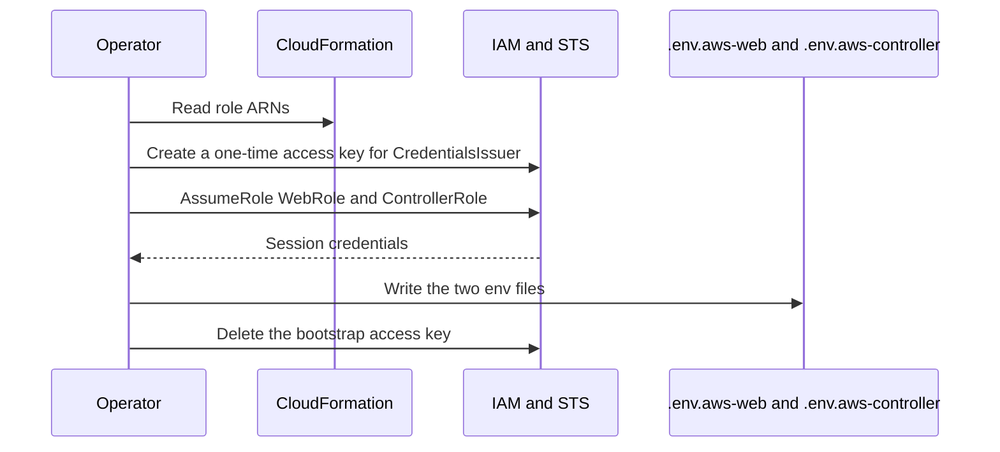

The burst path, from a cold instance to a published result:

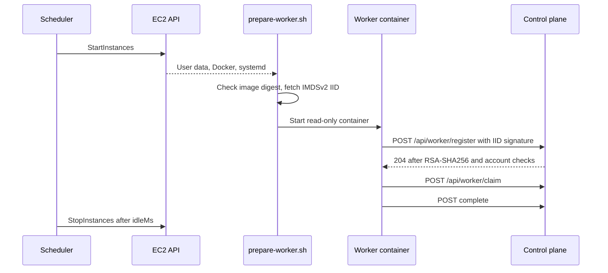

A lightly used month of the always-on pieces is about $33 to $36 before credits: the `t3.small` app host ($15.18), RDS `db.t4g.micro` ($11.68), gp3 volumes (about $4.22), and three Secrets Manager secrets (about $1.20 plus request charges). API Gateway, logs, S3, ECR, and the burst instance vary with use. The burst instance is stopped while idle. Storage, transfer, and monitoring are outside the EC2 compute figure shown in Operations.

The November 2026 acceptance notes in [aws/HOSTED.md](aws/HOSTED.md) record a local 250 Hz download, an EC2 deadline rescue while both local slots were busy, a run that finished after the laptop workers were gone, and job rows that survived an app restart.

---

## Observability and Evaluation

Every 5 seconds the scheduler calls `telemetryPublisher`. It ships up to 50 unsent `telemetry` rows to the `controller` log stream in `/ucs531/scheduler` (dropping anything older than 14 days), then once a minute publishes `UCS531/Scheduler` metrics.

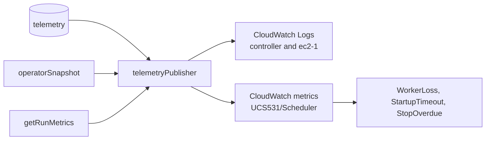

| Metric | Meaning |
|--------|---------|
| `QueueDepth`, `RunningJobs` | Current queue and running counts |
| `OldestQueueWait` | Age of the oldest queued job, in seconds |
| `HealthySlots` | Workers seen inside `leaseMs` |
| `WorkerLoss` | Attempts lost since the previous publish |
| `StartupTimeout` | Cloud sessions that missed `startupMs` |
| `StopOverdue` | Stop requested longer than `stopGraceMs` |
| `StartupDelay` | Latest observed boot, in seconds |
| `DeadlineHits`, `DeadlineMisses` | Outcomes for the active run |
| `EstimatedComputeUsd` | Observed EC2 compute for the run |

Alarms in `aws/cloud-observability.yaml` fire at a threshold of 1 for `WorkerLoss`, `StartupTimeout`, and `StopOverdue`. The `ec2-1` log stream is the container's `awslogs` output.

### Tests

```sh
npm run typecheck
npm run build
npm test
```

| File | What it locks down |
|------|--------------------|
| `tests/policy.test.ts` | QoS stays local when local is on time, budget blocks, and the three rankings disagree. |
| `tests/auth.test.ts` | Same-origin checks. |
| `tests/aws-adapters.test.ts` | EC2 stop timestamps, IID signatures, presigned URL shape. |
| `tests/http-smoke.test.ts` | Needs `SMOKE_URL=http://localhost:3000` and a generated `.env`. Covers idempotent admission, ownership, upload recovery, and the 250 Hz result from a real worker. |
| `tests/lifecycle.test.ts` | Needs `TEST_DATABASE_URL`. Builds a disposable schema, then runs concurrent claims, a fenced retry, EC2 readiness, and idle stop against simulated AWS state. |

### Evaluation harness

`npm run evaluate` talks to `EVALUATION_API` with `EVALUATION_TOKEN` (the operator token). It writes timestamped per-run and comparison JSON under `evaluation-output/`.

| Mode | Shape |
|------|-------|
| `smoke` | Short end-to-end path. |
| `hybrid` | Three spaced jobs, then seven in a burst, including two long jobs that fill the local slots. Three repetitions per policy. |
| `full` | Twelve spaced arrivals and a burst while both local slots are busy. Policy order rotates across three paired repetitions. |

Set `EVALUATION_LONG_S`, `EVALUATION_SHORT_S`, and `EVALUATION_STARTUP_S` from a calibration pass before a full trace, and keep those values frozen across policies. `EVALUATION_NORMAL_INTERVAL_S` should sit above the normal fixture's service time. `EVALUATION_REQUIRE_EC2=true` checks that EC2 is configured and stopped before the replay, and that at least one on-time rescue recorded a later shutdown. Matching attempt ids and checksums land in `ec2-rescues.json` for comparison with CloudWatch.

`scripts/verify-hosted.ts` is the live check: `connected` (local health, then a burst rescue), `offline` (laptop workers gone), and `restart` (jobs survive a control-plane restart).

### Measured runs

Figures below are the November 2026 traces in [docs/evaluation.md](docs/evaluation.md). Each policy saw the same seeded recordings, arrivals, deadlines, and budgets. Every job produced a result, including jobs that finished late.

Local-only, 18 trials, 225 jobs. Normal demand met 108 of 108 deadlines. Burst:

| Policy | On-time jobs | Mean queue wait | Mean completion |
|--------|-------------:|----------------:|----------------:|
| FCFS | 17 / 39 | 5.01 s | 6.44 s |
| Priority | 19 / 39 | 4.41 s | 5.79 s |
| QoS | 18 / 39 | 4.60 s | 5.96 s |

Live hybrid, 18 trials, 90 jobs, local slots at `0.035` CPU, one `t3.small` in `us-east-1`, readiness forecast frozen at 33 seconds, compute rate `$0.0208` per hour. Normal demand met all 27 deadlines with EC2 left stopped.

| Policy | On-time | On-time high priority | Mean queue wait | Mean completion | EC2 results | Estimated EC2 compute |
|--------|--------:|----------------------:|----------------:|----------------:|------------:|-----------------------:|
| FCFS | 11 / 21 | 2 / 12 | 29.24 s | 46.00 s | 8 | $0.001752 |
| Priority | 15 / 21 | 6 / 12 | 21.73 s | 35.71 s | 11 | $0.001797 |
| QoS | 15 / 21 | 6 / 12 | 28.08 s | 47.08 s | 6 | $0.001546 |

QoS met four more burst deadlines than FCFS and tied priority, at about 14% lower estimated EC2 compute than priority. Priority had the shortest mean completion. Each policy started EC2 three times. Observed readiness ranged from 19.1 to 45.2 seconds. Zero-budget jobs stayed local. Stopping `local-1` mid-attempt expired the lease, `local-2` retried, and the `WorkerLoss` alarm moved from `OK` to `ALARM`.

---

## Repository Structure

```
QoS-Aware_Scheduler/
├── app/
│   ├── api/[...parts]/route.ts     # Catch-all into src/http.ts
│   ├── dashboard.tsx                # Sign-in, queue, submit, operator
│   ├── page.tsx                     # Cookie gate
│   ├── layout.tsx
│   ├── styles.css
│   └── tokens.css
├── src/
│   ├── http.ts                      # Routes, Zod errors, worker grants
│   ├── auth.ts                      # Tokens, cookies, CSRF, worker auth
│   ├── jobs.ts                      # Submit, admit, claim, finish, runs
│   ├── controller.ts                # Tick, expiry, EC2 reconcile, placement
│   ├── policy.ts                    # rankJobs, placeJob, serviceMs, cost
│   ├── domain.ts                    # States, limits, job spec, microdollars
│   ├── config.ts                    # Env defaults and run calibration
│   ├── db.ts                        # Pool, transactions, advisory lock
│   ├── artifacts.ts                 # S3 or local disk, presign, bounded reads
│   ├── cloud.ts                     # EC2 observe/act, IID verification
│   ├── metrics.ts                   # Run aggregates and operator snapshot
│   ├── telemetry.ts                 # CloudWatch logs and metrics
│   └── vibration.ts                 # CSV parse and lag score
├── scripts/
│   ├── scheduler.ts                 # 1s control loop, 5s telemetry
│   ├── worker.ts                    # Claim, heartbeat, subprocess
│   ├── compute.ts                   # stdin CSV to stdout JSON
│   ├── migrate.ts                   # Apply db/*.sql in order
│   ├── init-env.ts                  # Write a private .env
│   ├── evaluate.ts                  # Policy comparison harness
│   ├── verify-hosted.ts             # Connected, offline, restart checks
│   ├── hosted-secrets.ts            # Derive tokens from RuntimeSeed
│   └── worker-relay.ts              # TLS relay onto an SSM tunnel
├── db/
│   ├── 001_initial.sql
│   └── 002_controller_state.sql
├── aws/                             # CloudFormation, systemd, bind scripts
├── docs/
│   ├── evaluation.md
│   └── submission/                  # Proposal, architecture, demo, sample CSV
├── tests/
├── compose.yaml                     # Full local stack
├── compose.workers.yaml             # Laptop slots against a remote API
├── compose.aws.yaml                 # Identity mounts and pinned images
├── Dockerfile
└── .env.example
```

---

## Getting Started

### Prerequisites

- Node.js 22 or newer
- Docker with Compose
- No AWS account for the local stack

### Local demo

```sh
npm ci
npm run env:init
docker compose up --build -d
docker compose ps
```

Open [http://localhost:3000](http://localhost:3000). The generated `.env` holds the operator token (Operations, runs) and the student token (submit and track). Each account sees only its own jobs. `npm run env:init` refuses to overwrite an existing `.env`.

Submit `docs/submission/sample-vibration.csv` with sample rate 1,000 Hz, lag range 2 to 4, expected local runtime 1 second, a future deadline, and budget `0`. The job detail shows queue time, the worker that claimed it, the forecast, and whether the deadline held. Local artifacts and Postgres persist in Compose volumes. `docker compose down` stops the stack. Add `-v` when you want those volumes removed.

### Scripts

| Script | Command |
|--------|---------|
| `npm run dev` | Next.js dev server |
| `npm run build` / `npm start` | Production bundle and server |
| `npm run env:init` | Create `.env` |
| `npm run db:init` | Apply `db/*.sql` |
| `npm run scheduler` | Control-plane loop |
| `npm run worker` | One worker process |
| `npm run evaluate` | Policy comparison |
| `npm run typecheck` | `tsc --noEmit` |
| `npm test` | `tsx --test tests/*.test.ts` |

Useful environment, also listed in `.env.example`:

| Variable | Role |
|----------|------|
| `POSTGRES_PASSWORD`, `SESSION_SECRET` | Database and cookie signing |
| `DASHBOARD_ACCOUNTS` | Operator and student tokens |
| `WORKER_TOKEN_LOCAL_1`, `WORKER_TOKEN_LOCAL_2` | Local slot secrets |
| `POLICY` | `qos`, `priority`, or `fcfs` |
| `LOCAL_WORKER_CPUS` | Compose CPU quota for each local slot |
| `RUN_BUDGET_USD` | Default run budget, `1` |
| `EC2_START_ESTIMATE_S` | Cold-start forecast, default 45 |
| `AWS_S3_BUCKET`, `EC2_INSTANCE_ID` | Turn on S3 and the burst worker together |
| `COOKIE_SECURE` | Set `true` behind HTTPS |
| `PUBLIC_ORIGIN` | Origin check behind API Gateway |

EC2 mode also requires the account id, identity certificate, image digest, hourly rate, rate source, rate date, and a CloudWatch log group. `src/config.ts` refuses a half-configured instance.

Hosted sign-in, laptop workers, and the CloudFormation order are in [aws/HOSTED.md](aws/HOSTED.md). The lab AWS checklist is in [aws/README.md](aws/README.md).

---

## Glossary

| Term | Meaning |
|------|---------|
| **Admit** | Move `AWAITING_INPUT` to `QUEUED` after the CSV checksum and upload window pass. |
| **Attempt** | One execution of a job on one worker generation. A job may have a second attempt after a transient failure. |
| **Capacity session** | Row tracking an EC2 start: requested, running, ready, idle, stop requested, stopped. |
| **Cloud rescue** | QoS choice `cloud_rescues_deadline`: local would miss, EC2 is forecast to hit, and both budgets allow it. |
| **Decision** | JSON stored on the job: selected target, both finish forecasts, reason, reservation, deadline risk. |
| **Generation** | UUID minted when a worker process starts. Claims and heartbeats must present the generation that registered. |
| **Lease** | `lease_until` on an attempt. Heartbeats push it forward. Expiry returns the job to the queue or fails it. |
| **Microdollar** | One millionth of a USD. Budgets, reservations, and EC2 charges are integers in this unit. |
| **Run** | A named grouping of jobs under one policy, calibration, and budget. Only one run is active. |
| **Slot** | `local-1`, `local-2`, or `ec2-1`. Each slot holds one `ASSIGNED` or `RUNNING` job. |
| **StageFailure** | Worker-reported cause: fetch, input, compute, upload, or timeout. |
| **Watchdog** | On-instance script that powers EC2 off when the worker stops contacting the controller. |
