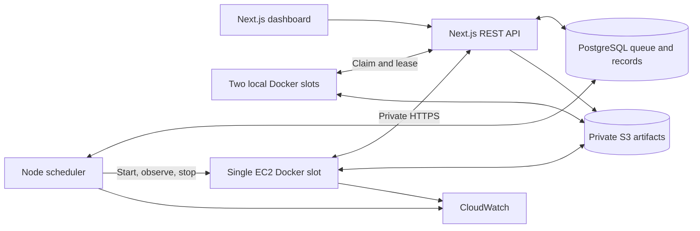

# QoS-Aware Hybrid Cloud Task Scheduler

UCS531 Cloud Computing project. Submit a vibration recording, follow its placement decision, and download the computed frequency and lag scores. A PostgreSQL queue feeds two single-slot local workers. The QoS policy starts or reuses one EC2 worker when it can rescue a deadline within the job and run budgets.

## Run the local demo

Use Node.js 22 or newer and Docker Compose.

```sh
npm ci
npm run env:init
docker compose up --build -d
docker compose ps
```

Open [the dashboard](http://localhost:3000). Use the operator token in the generated `.env` for the Operations view or the student token for job submission and tracking. Both accounts own their individual submissions.

Save this as a one-column CSV and submit it with sample rate 1,000 Hz, lag range 2–4, expected local runtime 1 second, a future deadline, and a zero cloud budget.

```csv
sample
2
0
-2
0
2
0
-2
0
```

The result includes scores `[-2, 0, 2]`, lag `4` and frequency `250` Hz. The job detail shows when it queued and ran, which worker claimed it, its forecast and how the deadline turned out. Local artifacts and PostgreSQL persist in Compose volumes. `docker compose down` stops the stack.

## Design



Next.js handles short requests. A separate Node.js scheduler forecasts free times and reserves slots transactionally. Workers pull their assignments and run the allowlisted analysis in a subprocess, so computing a large recording does not block lease renewal. A fenced attempt writes an immutable artifact and publishes one pointer in PostgreSQL after checksum verification. A timed-out or lost attempt can retry once. A missed deadline is recorded as an outcome and the result remains downloadable on success.

| Policy | Queue order | Placement |
|---|---|---|
| FCFS | Enqueue timestamp, then job ID | Local first. If both local slots are busy, use affordable EC2 when it can start sooner. |
| Priority | High, normal, low, then FCFS | Same placement as FCFS. |
| QoS | Oldest jobs waited at least 120 seconds, then priority and latest viable local start | Local when it can finish on time. Use affordable EC2 when its forecast rescues the deadline. Fall back to best effort. |

The forecast combines committed work, earlier jobs in policy order, calibrated compute and transfer times, and EC2 readiness. Placement records contain both predicted finishes, reasons and the budget comparison. Budgets use integer microdollars. The cloud cost shown in Operations estimates billed EC2 compute from observed running time, with one minimum billing interval per start. When EC2 reports a valid stop transition time, the estimate uses that timestamp even if the controller was offline. Charges for storage, data transfer, monitoring and networking are separate.

### HTTP interface

Use `Authorization: Bearer <project-token>` for scripts. The dashboard uses an HttpOnly session cookie. Operator credentials are required on the run endpoints.

| Method and path | Purpose |
|---|---|
| `POST /api/jobs` | Submit metadata with an `Idempotency-Key` header. |
| `PUT /api/jobs/{id}/input` | Upload CSV bytes matching the SHA-256 provided at submission. |
| `GET /api/jobs` | List owned jobs with optional `state`, `priority`, `target`, and `offset` filters. |
| `GET /api/jobs/{id}` | View job state, forecast, and attempts. |
| `GET /api/jobs/{id}/events` | Read the job timeline. |
| `GET /api/jobs/{id}/result` | Download the verified result. In AWS mode, follow the signed S3 redirect. |
| `GET /api/runs/operations` | Inspect queue, workers, and EC2 lifecycle. |
| `GET /api/runs/{id}/metrics` | Get the aggregate metrics and EC2 sessions for a run. |

Job fields are `type` (`vibration-v1`), `sampleRate`, `minLag`, `maxLag`, `priority`, `expectedSeconds`, `deadline` (ISO 8601 with offset), `budgetUsd` (decimal string), and `inputSha256` (lowercase hex). Input is limited to 2 MiB, 250,000 samples, and 2,048 candidate lags. An optional header row must read `sample`.

## Verify and compare

```sh
npm run typecheck
npm run build
npm test
```

Set `TEST_DATABASE_URL` to a PostgreSQL database that permits disposable schemas to run the database lifecycle test. It exercises concurrent claims, a fenced retry, EC2 readiness and idle stop using simulated AWS state. The local Compose stack can run with no AWS account.

Set `SMOKE_URL=http://localhost:3000` and run `npm test` with the local stack running and the generated `.env` present. The HTTP test checks idempotent admission, job ownership, upload recovery, and the published 250 Hz result from a real worker.

Set `EVALUATION_TOKEN` to the operator token and `EVALUATION_API` to the dashboard origin, then run `npm run evaluate`. For a short end-to-end run set `EVALUATION_MODE=smoke`. The full trace uses 12 spaced arrivals and a burst while local slots are occupied. It rotates policy order across three paired repetitions and writes timestamped per-run and comparison JSON files under `evaluation-output/`.

Before collecting full results, benchmark the generated workload on both targets. Set the same frozen startup, throughput, runtime ratio and fixed overhead values for all policies. Set `EVALUATION_LONG_S`, `EVALUATION_SHORT_S` and `EVALUATION_STARTUP_S` to the observed planning estimates. The CSV size and lag range bound the work. If a fast lab host drains the entire burst before EC2 can start, lower `LOCAL_WORKER_CPUS` for a controlled experiment, recalibrate, and record the quota as part of the run setup. Verify that the long fixtures finish inside 180 seconds. Report both configurations if comparing that experiment to an unrestricted lab.

Set `EVALUATION_NORMAL_INTERVAL_S` to replay normal demand at a measured arrival interval. Keep the interval comfortably above the normal fixture's service time. In AWS mode, set `EVALUATION_REQUIRE_EC2=true` to check that EC2 is configured and stopped before the replay and require at least one recorded on-time rescue with observed shutdown. The CLI writes matching attempt IDs and checksums to `ec2-rescues.json` for comparison with the CloudWatch stream.

For a shorter live comparison, use `EVALUATION_MODE=hybrid`. Each policy receives three spaced jobs for normal load and seven jobs for the burst, including two long jobs that occupy the local slots before the urgent arrivals. Set `EVALUATION_LONG_S`, `EVALUATION_SHORT_S`, and `EVALUATION_STARTUP_S` from your measured local service and cold-start timings. The mode still runs three repetitions per policy by default.

The output reports mean and p95 queue wait, queue wait by priority, retry wait, deadline hits including unclaimed jobs, completion time, makespan, EC2 usage and estimated compute cost. A cloud rescue needs a corresponding verified EC2 claim and a result published by the deadline. Compare additional on-time jobs and their incremental cost against each baseline.

See [AWS setup](aws/README.md) for the live-burst checklist.
