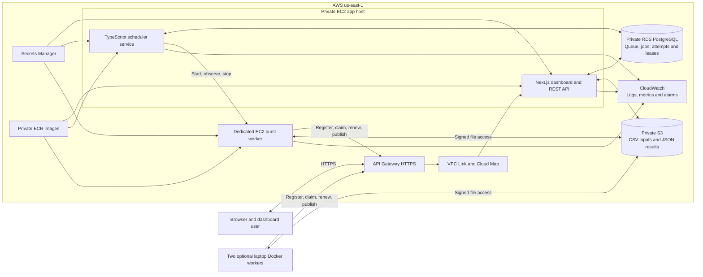

# Deployed System Architecture

The web process validates an upload and admits the job to the PostgreSQL queue. The scheduler ranks eligible jobs, forecasts worker finish times, and reserves an assignment in PostgreSQL. A worker claims the job, obtains scoped file URLs, evaluates the signal, and uploads a result for its attempt. The API verifies the checksum before publishing the winning result. The browser downloads it through the same authenticated HTTPS URL.

Web and scheduler processes run as separate services. Their durable queue and artifact records survive process restarts. Laptop workers connect only as optional execution capacity. CloudFormation describes the deployment, and the running application uses the private API Gateway VPC integration. [Deployed resource inventory](../../aws/HOSTED.md)
